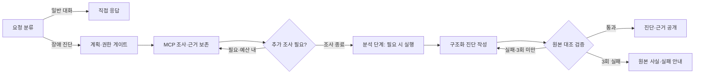

# 근거를 검증하는 운영 장애 진단 에이전트

**SKALA AI 서비스 Mini-project · 주제 1 · G101 최도한**

모니터링 지표와 대응 매뉴얼을 조회해 장애를 진단하고, 답변의 **관측 사실·원인 가설·권장 조치**를 구분합니다. 관측 사실의 시스템명·값·단위·출처를 원본과 대조한 뒤 결과를 공개하여, 사용자가 진단의 근거와 검증 범위를 확인할 수 있도록 개선했습니다.

기능 구현은 완료되었으며, 로컬 모델 개발 평가와 OpenAI 최종 테스트를 수행했습니다. 모니터링은 교육용 샘플 데이터이며 실제 운영 시스템에 연결하거나 복구 명령을 실행하지 않습니다.

## 주요 개선

| 항목 | 제공 예제 | 개선 후 |
|---|---|---|
| 답변 | 자유 텍스트 | 관측 사실·원인 가설·권장 조치 분리 |
| 근거 | 수집한 데이터 중심 | 요청별 근거 ID, 대상 시스템, 조회 시각, 원본 값, 문서 URI 보존 |
| 검증 | 길이·번호 형식 검사 | Pydantic 구조 검사 + 원본과 시스템·항목·값·단위·출처 연결 대조 |
| 재작성 | 최대 시도 후 강제 통과 | 오류 코드·위치·수정 안내 전달, 최초 작성 포함 3회 실패하면 실패로 종료 |
| 결과 공개 | 검증 전 초안 스트리밍 | 장애 초안은 검증 후 공개, 실패하면 확인 가능한 원본 사실과 실패 안내 표시 |
| 화면 | 답변 본문 | 세 영역 분리, 검증 범위·상태, 응답별 근거 펼쳐보기 |

검증은 **v2 장애 진단 경로**에 적용됩니다. 일반 대화와 v1은 검증 비대상으로 구분합니다. 원인 가설의 인과관계, 조치의 효과, 출처 자체의 진실성까지 자동 검증하는 것은 아닙니다.

## 구성과 처리 흐름

- **FastAPI + SSE:** REST 응답과 실시간 진행 이벤트, 검증된 최종 결과 제공.
- **LangGraph:** 라우팅, 계획, 조사, 선택적 분석, 작성·검증·재작성 흐름 제어.
- **MCP:** Tool로 모니터링 조회, Resource로 키워드에 맞는 매뉴얼 조회, Prompt로 조사 절차 제공. 조회한 문서를 생성 컨텍스트에 활용합니다.
- **Pydantic + 의존성 주입:** 진단·근거 계약과 검증기를 분리하고 모델·MCP·세션 의존성을 교체하여 검사합니다.
- **Vue 3 + SQLite:** 근거 확인 UI와 대화 저장. Vue는 CDN 방식으로 별도 프론트엔드 빌드가 없습니다.
- **LangSmith:** 그래프 단계와 MCP 호출·재시도 흐름 추적.



코드: [그래프](agent/graph.py) · [근거 모델](agent/evidence.py) · [진단 모델](agent/diagnosis.py) · [검증기](agent/validation.py) · [API](server.py) · [화면](web_chat.html).

## 실행 방법

Python과 Bash 환경이 필요하며, 로컬 모델 실행에는 Ollama를 설치해야 합니다. 아래 명령은 저장소 루트에서 실행합니다.

```bash
git clone https://github.com/DoHanChoi/skala-mini-project-ai.git
cd skala-mini-project-ai
bash sh/setup_venv.sh
# 처음 설정할 때만 복사하고, 기존 .env가 있으면 유지합니다.
cp -n .env.example .env
```

`.env`에는 사용할 서비스의 키를 직접 설정합니다. LangSmith 추적에는 `LANGCHAIN_API_KEY`, `LANGCHAIN_TRACING_V2=true`를 사용하고, 최종 OpenAI 테스트에는 `OPENAI_API_KEY`가 필요합니다. 추적 없이 실행하려면 `LANGCHAIN_TRACING_V2=false`로 설정합니다. 실제 키는 커밋하지 않습니다.

`.venv`와 설치 패키지는 터미널 종료 후에도 남습니다. 실행 스크립트가 `.venv`를 자동 사용하므로 매번 활성화할 필요는 없습니다. 터미널에서 직접 `python`을 사용할 때는 `source .venv/bin/activate` 또는 `./.venv/bin/python`을 사용합니다.

**개발 테스트 — 로컬 Ollama**

```bash
bash sh/setup_ollama.sh
bash sh/run_agent_ollma.sh
```

기본 모델은 빠른 처리용 `qwen3:0.6b`, 진단 작성용 `qwen3:8b`입니다. 첫 설정은 모델 다운로드가 필요합니다.

**최종 테스트 — OpenAI**

```bash
bash sh/run_agent_openai.sh
```

기본 모델은 `gpt-4o-mini` / `gpt-4o`입니다. 실행 확인 후 실제 API를 사용하며 요청에 따라 비용이 발생합니다. Ollama와 OpenAI 백엔드는 같은 8100 포트를 사용하므로 하나를 선택해 실행합니다.

**화면 — 별도 터미널**

```bash
bash sh/run_frontend.sh
```

브라우저에서 <http://localhost:8600>에 접속합니다. 백엔드는 <http://127.0.0.1:8100>입니다.

질문 예시: `auth-service 로그인 응답이 느려졌어요. 원인 확인해주세요` 또는 `web-01 CPU 급증 원인 진단해줘`.

> 현재 실행 스크립트는 시작 시 해당 포트의 기존 프로세스를 종료하며, 백엔드 스크립트는 `session.db`를 삭제합니다. 기존 대화를 보존하려면 실행 전 DB를 백업하세요.

## 검증과 최종 실측

자동 검사는 외부 모델 대신 대역·고정 데이터·임시 DB를 사용합니다. UI 검사에는 Node.js가 필요합니다.

```bash
./.venv/bin/python -m unittest discover -s tests -v
./.venv/bin/python tests/run_pinned_baseline.py
node --test tests/ui.test.cjs
```

개발용 오류 주입 시험에서 잘못된 초안 검출은 기준 **0/18 → 개선 18/18**, 정상 초안 오탐은 양쪽 **0/6**이었습니다. 이는 정해진 사례의 검증기 시험이며 실제 모델의 전체 답변 정확도를 의미하지 않습니다. [시험 조건·로컬 모델 결과](doc/EVALUATION.md)

**2026-10-21 OpenAI 최종 비교:** 같은 3개 질문과 고정 근거를 `gpt-4o`, temperature 0으로 버전별 1회 실행했습니다. 실제 MCP·라우팅은 고정한 작성·검증 경로 비교입니다.

| 측정 항목 | 개선 전 | 개선 후 |
|---|---:|---:|
| 평균 요청 시간 | 1.99초 | 2.66초 |
| 입력 + 출력 토큰 합계 | 1,255 | 7,997 |
| 작성 모델 호출 합계 | 3회 | 5회 |

CPU·메모리 질문은 개선 후 각각 최초 작성에 통과했습니다. 반환한 관측은 각각 **6/6 원본 일치**, 전체 기대 사실 포함은 **6/7**로 알림 1개씩 빠졌습니다. 미인식 시스템은 세 번 작성 후 검증 실패로 종료하며, 원본의 대체값 `0`을 유효한 실측으로 공개하지 않았습니다.

**트레이드오프:** 검증 기준과 근거를 입력에 추가하고 오류 시 재작성하면서, 이 표본에서 평균 지연은 약 **34%**, 총 토큰은 **6.37배** 증가했습니다. 미인식 시스템의 추가 재작성 두 번이 개선 후 토큰의 약 34%를 차지했습니다. 검증 실패를 성공으로 게시하지 않는 경계를 확보했지만, 속도·비용 개선을 달성한 결과는 아닙니다. 토큰 배수는 실제 청구 비용 배수가 아니며, 3개 질문·1회 측정으로 운영 성능을 일반화할 수 없습니다.

[최종 평가 조건·상세 수치·한계](doc/FINAL_EVALUATION.md) · [공개 측정 요약 JSON](evaluation/results/openai-final-summary.json)

## 남은 한계와 개선 방향

- **불필요한 재작성:** 유효한 원본이 없는 경우를 작성 전에 판별해 조기 종료하거나 확인 질문으로 전환.
- **입력 토큰 증가:** 필요한 근거·스키마·실패 피드백만 전달하도록 컨텍스트 축소.
- **검증 범위:** 관측 누락과 가설·조치의 의미적 근거를 별도 평가하고, 미인식 대상의 확인 절차 개선.
- **평가 규모:** 개발에 쓰지 않은 질문과 반복 측정으로 품질·지연·실제 비용을 함께 검증.

위 항목은 후속 개선 아이디어이며 현재 구현 완료 범위에 포함되지 않습니다.

## 최종 발표자료

최종 제출 자료는 **본편 9장·부록 2장, 총 11장**이며, 본편은 5분 발표 기준입니다. 부록에는 전체 비교 결과와 전체 Graph·LangSmith 추적을 담았습니다. Graph는 기본 흐름을 실선, 재조사·재작성 경로를 점선으로 구분합니다.

파일명은 `광주_3반_G101_최도한_최종보고서.pptx`와 같은 이름의 `.pdf`입니다. 두 파일은 앱 저장소를 담은 로컬 프로젝트 폴더의 최상위에 보관하며, 이 GitHub 저장소에는 포함하지 않습니다. 이전 발표자료 PPT·PDF는 정리하고 최신본 두 개를 남겼습니다. 원본 실측과 실행 증빙은 보존했으며, 발표자료 수정 과정에서 모델 평가를 다시 실행하거나 위 수치를 변경하지 않았습니다.

## 문서 안내

| 문서 | 내용 |
|---|---|
| [실행·구성 상세](doc/README.md) | 제공 예제 구성과 실행 안내. 현재 응답 계약은 아래 통합 문서 참조 |
| [로컬 모델 사용법](doc/manual_ollma.md) / [OpenAI 사용법](doc/manual_openai.md) | 요청·화면 사용 예 |
| [근거 보존](doc/EVIDENCE.md) / [진단 검증](doc/VALIDATION.md) | 원본과 출처 모델, 검사 범위 |
| [모델·그래프·API 통합](doc/PIPELINE.md) / [근거 확인 UI](doc/UI.md) | 재작성·실패 종료·REST/SSE·화면 계약 |
| [빈 알림 처리](doc/ALERT_REWRITE.md) | 빈 알림 관측 생성 방지 안내와 피드백 |
| [기준 동작](doc/BASELINE.md) / [개발 평가](doc/EVALUATION.md) / [최종 평가](doc/FINAL_EVALUATION.md) | 버전별 시험 조건과 결과 |
| [초기 개발 계획](doc/PLAN_A.md) / [진행 기록](doc/WORK_LOG.md) | 설계와 이슈별 변경 이력 |
| [작업 규칙](AGENTS.md) / [CodeRabbit 리뷰](doc/CODERABBIT.md) | 이슈 → 브랜치 → PR → 리뷰 → 머지 → 이슈 종료 → 브랜치 정리 |

한 번에 이슈 하나를 진행하며, 완료 후 다음 이슈 착수 승인을 받습니다. `.env`, 가상환경, 세션 DB, 캐시와 실행 로그는 Git 추적 대상에서 제외합니다.
